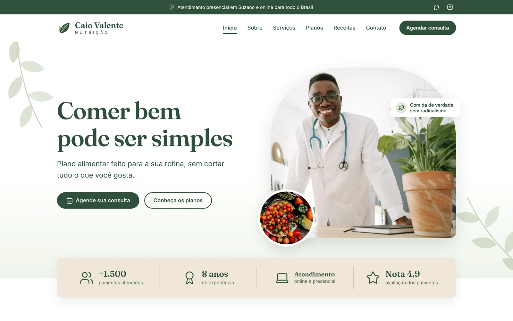

# Caio Valente Nutrição

Site institucional de um nutricionista **fictício**, criado como projeto de portfólio por **LS Luccas Souza**.

> **Aviso:** projeto fictício desenvolvido para portfólio por LS Luccas Souza. Nenhum atendimento real é oferecido neste site. O profissional, a marca, os pacientes, os depoimentos e os números são inventados. Telefones e e-mails exibidos não funcionam, e os botões de agendamento abrem apenas um aviso de demonstração.

**Site publicado:** https://luccas-souza7.github.io/consultorio-de-nutricao/



<details>
<summary>Ver a página inicial completa</summary>


</details>

## O que tem no site

- **Página inicial** com 16 seções, na ordem do mock de referência: barra de topo, cabeçalho fixo com menu hambúrguer, hero, faixa de números com contagem animada, sobre, público atendido, serviços expansíveis, como funciona, planos, mockup de aplicativo feito em HTML e CSS, carrossel de depoimentos com arrasto, receitas, e-book com formulário validado e consentimento LGPD, perguntas frequentes, faixa de CTA e rodapé com mapa e feed de fotos.
- **Extras:** botão flutuante de WhatsApp, voltar ao topo, banner de cookies (Aceitar, Recusar, Saiba mais) e modal de projeto demonstrativo.
- **Páginas internas:** Termos de Uso, Política de Privacidade (LGPD), Política de Cookies, índice de receitas, três receitas com conteúdo original e página 404.
- **Design system:** [`design-system.html`](design-system.html), catálogo vivo com tokens e componentes reais do site.

## Tecnologias

- HTML5 semântico
- CSS puro com variáveis (custom properties), sem framework
- JavaScript puro, sem dependências e sem etapa de build
- Google Fonts (Fraunces e Inter), ícones Lucide em SVG, mapa do OpenStreetMap
- GitHub Pages para hospedagem
- Playwright, axe-core e Lighthouse para testes

## Estrutura de pastas

```
.
├── index.html                    # página inicial
├── termos-de-uso.html
├── politica-de-privacidade.html
├── politica-de-cookies.html
├── design-system.html            # catálogo do design system
├── 404.html
├── receitas/
│   ├── index.html
│   ├── marmitas-da-semana.html
│   ├── lanches-para-o-trabalho.html
│   └── antes-do-treino.html
├── assets/
│   ├── css/styles.css            # todo o estilo do site
│   ├── css/design-system.css     # estilos exclusivos do catálogo
│   ├── js/main.js                # interações
│   ├── img/                      # fotos WebP, logo, folhas e imagem de compartilhamento
│   └── icons/                    # SVGs do Lucide usados no site
├── referencia/                   # mock, wireframe tipado e prints
├── favicon.svg
├── sitemap.xml
├── robots.txt
├── CREDITOS.md
└── LICENSE
```

## Decisões de design

- **Paleta restrita a cinco tokens:** `--verde-floresta` (#2F4F3A) para títulos, botões e rodapé; `--verde-salvia` (#9CAF88) para ícones e destaques; `--verde-claro` (#DCE8D2) e `--bege` (#EFE6D8) para fundos e cards; `--branco` (#FFFFFF) como base. Nenhuma outra cor é usada fora das fotos.
- **Tipografia:** Fraunces, uma serifada orgânica, nos títulos, e Inter no texto corrido, as duas com licença OFL e `display=swap`.
- **Estilo:** muito espaço em branco, cantos de 12 a 16 px, sombras suaves em verde e folhas decorativas em SVG nos cantos de algumas seções.
- **Ética profissional (CFN):** sem fotos de antes e depois, sem promessa de resultado e sem indicação de produto ou suplemento de marca. Dados de saúde nunca são pedidos pelo site.

### Acessibilidade

- Todo texto usa verde-floresta sobre fundos claros, com contraste de 7,2:1 a 9,1:1 (nível AAA).
- `lang="pt-BR"`, link "Pular para o conteúdo", foco visível em todos os elementos interativos e alvos de toque de pelo menos 44 px.
- Menu, modal (`<dialog>` nativo), carrossel (setas e teclado), cards de serviço (`aria-expanded`) e acordeão (`<details>`) funcionam pelo teclado.
- Formulário com rótulos, mensagens de erro ligadas por `aria-describedby` e `aria-invalid`.
- Animações desligadas com `prefers-reduced-motion`; o conteúdo continua visível sem JavaScript.

### Desempenho e SEO

- Fotos em WebP com `width` e `height` definidos e `loading="lazy"` (exceto a do hero, com `fetchpriority="high"`).
- `title`, `meta description`, Open Graph com imagem de compartilhamento, favicon SVG, `sitemap.xml`, `robots.txt` e dados estruturados JSON-LD do tipo `WebSite` em todas as páginas.

## Como rodar localmente

Não há instalação nem build. Na pasta do projeto:

```bash
python -m http.server 8000
```

Depois, abra http://localhost:8000 no navegador.

## Créditos e licença

- Origem de cada foto, fonte e ícone: [CREDITOS.md](CREDITOS.md).
- Código e textos: todos os direitos reservados, Luccas Souza, 2026. Apenas visualização para avaliação de portfólio. Veja [LICENSE](LICENSE).

## Autor

**Luccas Souza** (LS Luccas Souza)

- GitHub: [github.com/luccas-souza7](https://github.com/luccas-souza7)
- LinkedIn: [linkedin.com/in/luccas-souza7](https://linkedin.com/in/luccas-souza7)
