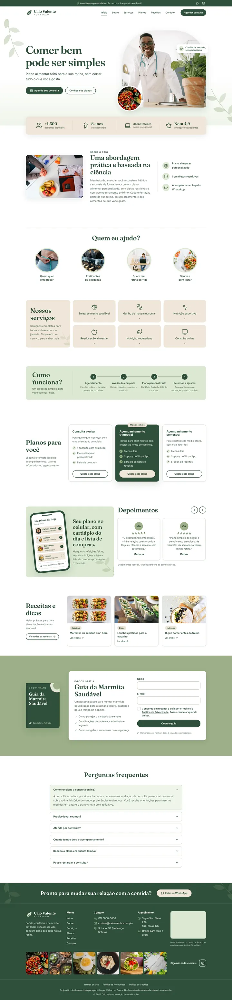

# Caio Valente Nutrição

Site institucional de um nutricionista **fictício** em São Paulo (SP), criado como projeto de portfólio por **LS Luccas Souza**.

> **Aviso:** projeto fictício desenvolvido para portfólio por LS Luccas Souza. Nenhum atendimento real é oferecido neste site. O profissional, a marca, o registro profissional, os pacientes, as avaliações e os números são inventados, e os preços são valores de exemplo. Os botões de contato abrem o WhatsApp do autor, apenas como demonstração.

**Site publicado:** https://luccas-souza7.github.io/consultorio-de-nutricao/


<details>
<summary>Ver a página inicial completa</summary>



</details>

## Destaques

- **Hero com vídeo** que ocupa exatamente a primeira tela (Pexels), com sobreposição na cor da marca, botão de pausar e versões otimizadas para desktop e celular.
- **Animações no nível de um site Webflow premium**, feitas com GSAP (ScrollTrigger, SplitText): títulos revelados por linhas, cards em sequência, imagens com máscara, parallax, faixa de serviços em movimento, cabeçalho que se esconde ao rolar, FAQ com abertura animada, botões com preenchimento e efeito magnético, rolagem suave e leve (Lenis) com barra de rolagem discreta, e transição entre páginas (View Transitions).
- **Planos com preços de exemplo e desconto progressivo** (avulsa, trimestral e semestral), com ancoragem de preço, economia em destaque, selos "Mais escolhido" e "Melhor custo-benefício" e tabela comparativa.
- **Todos os botões de contratação abrem o WhatsApp**, com o ícone oficial do WhatsApp e uma mensagem pronta que identifica o plano escolhido. Botão flutuante no verde do WhatsApp.
- **Avaliações no estilo Google**, claramente marcadas como demonstrativas, prontas para receber as avaliações reais pela Google Places API.
- **Blog com artigos e receitas**: listagem com destaque, categorias, paginação, sumário automático, tempo de leitura, compartilhamento, "Leia também" e receitas com ingredientes marcáveis.
- **SEO por página**: URL amigável, `title`, `meta description`, canonical, Open Graph, JSON-LD (`WebSite`, `BlogPosting`, `Recipe`, `BreadcrumbList`), `sitemap.xml` e feed RSS gerados automaticamente.
- **Publicação sem código**: um formulário dentro do GitHub cria o artigo, otimiza as imagens e publica o site sozinho.
- **E-book real** ("Guia da Marmita Saudável") em PDF para download direto e em versão web acessível.
- **Localização em destaque**: mapa grande do OpenStreetMap da região da Paulista e dos Jardins, com informações em cards separados.

## Como publicar um artigo ou receita

Sem programar, pelo navegador:

1. No repositório, abra **Issues > New issue**.
2. Escolha **Novo artigo do blog** ou **Nova receita**.
3. Preencha título, resumo, categoria, data, arraste a imagem de capa, escreva o texto e envie.

Em cerca de 2 minutos o artigo está no ar, e a issue recebe o link. Para corrigir, basta editar a issue. Passo a passo completo, com dicas de formatação: [docs/COMO-PUBLICAR.md](docs/COMO-PUBLICAR.md).

## Tecnologias

| Área | Ferramenta |
|---|---|
| Gerador estático | [Eleventy 3](https://www.11ty.dev/) com templates Nunjucks |
| Conteúdo | Markdown com cabeçalho YAML, versionado no GitHub |
| Estilos | CSS puro com variáveis, empacotado com esbuild |
| Interações | JavaScript sem framework, empacotado com esbuild |
| Animações | GSAP 3 (ScrollTrigger, SplitText, CustomEase) e Lenis |
| Imagens | @11ty/eleventy-img (WebP responsivo com `srcset` automático) |
| Publicação | GitHub Actions e GitHub Pages (pronto para Cloudflare Pages) |
| Testes | Playwright, axe-core e Lighthouse |

Detalhes da arquitetura e das decisões: [docs/ARQUITETURA.md](docs/ARQUITETURA.md). Migração futura: [docs/MIGRAR-CLOUDFLARE.md](docs/MIGRAR-CLOUDFLARE.md).

## Estrutura de pastas

```
src/
  _data/              site.json, planos.json, avaliacoes.json, categorias.json
  _includes/          layouts e componentes (cabeçalho, rodapé, cards)
  blog/posts/         artigos e receitas, um arquivo .md por página
  legais/             termos, privacidade e cookies
  css/  js/           estilos e scripts
  assets/             imagens, vídeos, fontes e e-book
scripts/              novo-conteudo.mjs, atualizar-avaliacoes.mjs, gerar-ebook.mjs
.github/              formulários de issue e workflows de publicação
docs/                 guias e modelos de artigo
referencia/           mock original, wireframe e prints
```

## Rodar localmente

Requer Node.js 20 ou superior.

```bash
npm install
```

```bash
npm run dev
```

Abra http://localhost:8080. Para gerar a versão final em `_site/`:

```bash
npm run build
```

## Qualidade

- Acessibilidade: axe-core sem violações em todas as páginas (desktop e celular), navegação completa por teclado, foco visível, `prefers-reduced-motion` respeitado (sem vídeo e sem animações) e conteúdo visível mesmo sem JavaScript.
- Desempenho (Lighthouse): página inicial 100 no desktop e acima de 90 no celular nas quatro categorias; artigos acima de 90.
- Paleta restrita a cinco cores, com contraste AAA para todo texto sobre fundos claros.

## Créditos e licença

- Origem de cada foto, vídeo, fonte, ícone e biblioteca: [CREDITOS.md](CREDITOS.md).
- Código e textos: todos os direitos reservados, Luccas Souza, 2026. Apenas visualização para avaliação de portfólio. Veja [LICENSE](LICENSE).

## Autor

**Luccas Souza** (LS Luccas Souza)

- GitHub: [github.com/luccas-souza7](https://github.com/luccas-souza7)
- LinkedIn: [linkedin.com/in/luccas-souza7](https://linkedin.com/in/luccas-souza7)
