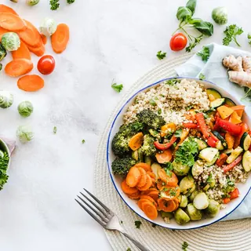

Montar um prato equilibrado não exige balança, aplicativo nem ingredientes caros. Um jeito prático é pensar no prato como um desenho dividido em partes, e encaixar ali a comida que você já tem em casa.

## O método do prato dividido

Imagine o prato raso dividido assim:

- **Metade com legumes e verduras:** folhas, tomate, cenoura, abobrinha, brócolis, chuchu, berinjela. Crus, cozidos ou assados.
- **Um quarto com proteína:** frango, peixe, ovos, carne magra, ou leguminosas como feijão, lentilha e grão-de-bico.
- **Um quarto com carboidrato:** arroz, batata, mandioca, macarrão, cuscuz ou outro cereal.

O clássico arroz com feijão já resolve boa parte da conta: juntos, eles formam uma combinação de proteína vegetal muito boa, além de fibras e minerais.



## Por que a metade de legumes faz diferença

Legumes e verduras trazem fibras, água, vitaminas e minerais com poucas calorias. Na prática, eles ajudam a dar volume ao prato e saciedade à refeição. Variar as cores ao longo da semana é uma forma simples de variar também os nutrientes.

### E se eu não gosto de salada?

Não precisa ser salada crua. Legumes assados com azeite e ervas, refogados, em sopas ou misturados ao arroz contam do mesmo jeito. Comece pelos que você já aceita e vá testando um novo por semana.

## Ajustes para cada rotina

O método é um ponto de partida, não uma regra fixa. Quem treina pesado pode precisar de mais carboidrato; quem tem menos fome à noite pode reduzir a porção do jantar. Em uma consulta, essas quantidades são ajustadas ao seu objetivo, ao seu horário e ao seu apetite.

## Checklist rápido

1. Metade do prato tem legumes ou verduras?
2. Tem uma fonte de proteína?
3. O carboidrato está em uma porção que sustenta até a próxima refeição?
4. Tem uma fonte de gordura boa, como um fio de azeite?

Para facilitar a semana, veja também como preparar [marmitas equilibradas em cerca de 1 hora](/blog/marmitas-da-semana/).
